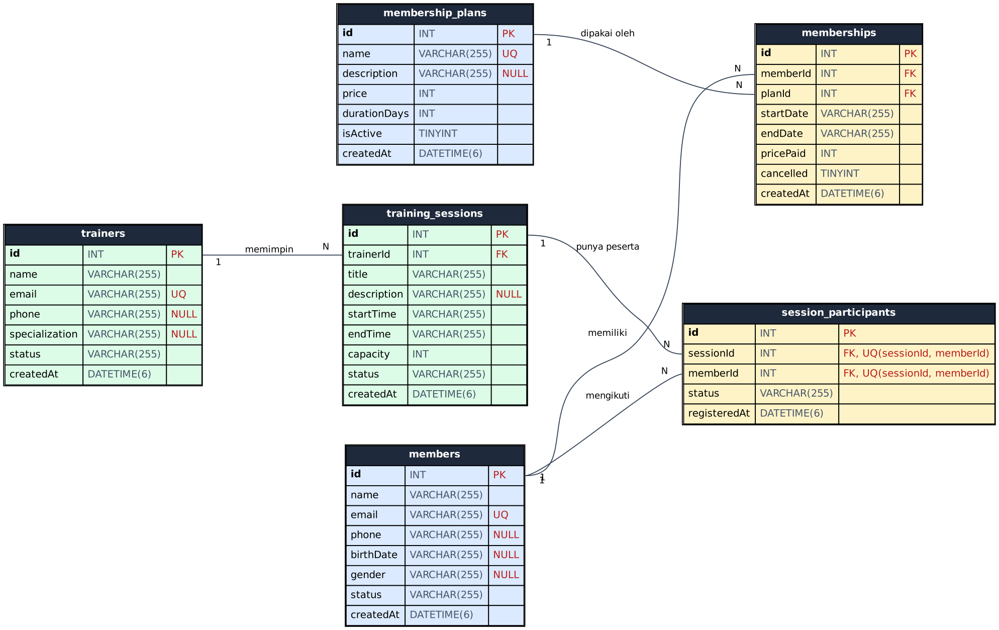
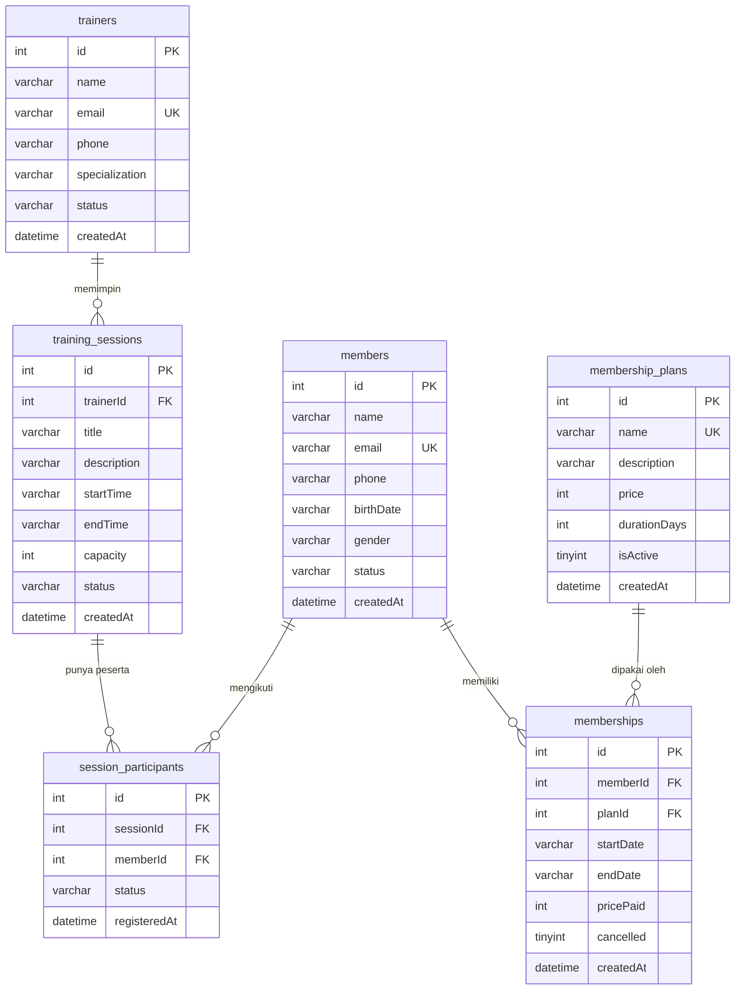

# ERD — Gym Management System

Database: **MySQL 8**, nama database `gym_db`. Gambar: [`ERD.png`](ERD.png) / [`ERD.svg`](ERD.svg). DDL lengkap: [`schema.sql`](schema.sql).

## Diagram (Mermaid)

## Relasi

| Relasi | Kardinalitas | Foreign key | Aksi hapus |
|---|---|---|---|
| `members` → `memberships` | 1 : N | `memberships.memberId` → `members.id` | RESTRICT |
| `membership_plans` → `memberships` | 1 : N | `memberships.planId` → `membership_plans.id` | RESTRICT |
| `trainers` → `training_sessions` | 1 : N | `training_sessions.trainerId` → `trainers.id` | RESTRICT |
| `training_sessions` → `session_participants` | 1 : N | `session_participants.sessionId` → `training_sessions.id` | RESTRICT |
| `members` → `session_participants` | 1 : N | `session_participants.memberId` → `members.id` | RESTRICT |
| `members` ↔ `training_sessions` | N : N | lewat tabel penghubung `session_participants` | — |

Constraint unik: `members.email`, `trainers.email`, `membership_plans.name`, dan pasangan (`session_participants.sessionId`, `session_participants.memberId`) agar anggota tidak terdaftar dua kali di sesi yang sama.

## Catatan desain

- `RESTRICT` pada semua FK: data yang masih dipakai tabel lain tidak bisa dihapus (API membalas 409).
- Tanggal keanggotaan disimpan sebagai teks `YYYY-MM-DD`; waktu sesi sebagai teks ISO 8601 UTC.
- `memberships.pricePaid` menyalin harga paket saat transaksi, sehingga perubahan harga paket tidak mengubah riwayat.
- Status keanggotaan (`upcoming/active/expired/cancelled`) tidak disimpan, tetapi dihitung dari tanggal dan kolom `cancelled`.
